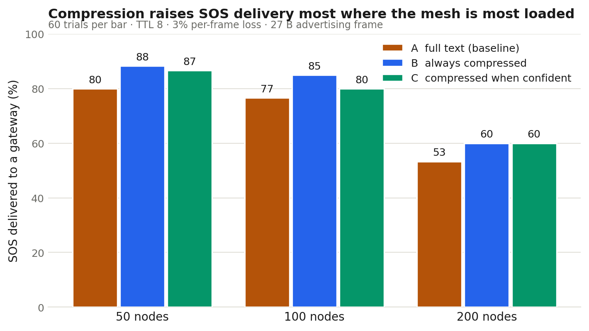

# MeshSOS — Semantic Compression: Results

Measured on this repository, 27 October 2026. Every number below is
reproducible with the commands in the last section.

---

## 1. What was built

A free-text emergency report is compressed on the handset into a 3-byte
semantic envelope and sent as a 25-byte authenticated frame — small enough
for one legacy BLE advertising packet. When the encoder is not confident, it
sends the original text instead.

| Component | File |
|---|---|
| 3-byte semantic envelope | `nlp/envelope.py` |
| Rule-based encoder, no training | `nlp/rules.py` |
| Envelope → rescuer text, triage score | `nlp/decoder.py` |
| 25-byte authenticated SOS | `protocol/compact_sos.py` |
| Size-aware mesh simulator | `simulator/network_simulator.py` |
| Evaluation harness | `simulator/eval_compression.py` |

---

## 2. Message size

The existing `SosMessage` is 124 bytes before a single character of text,
because it carries an Ed25519 public key (32 B) and signature (64 B) on the
wire. **96 of those 124 bytes are cryptography.** Compressing only the text
takes a typical report from 6 frames to 5; it can never reach 1.

Reaching one frame required three trades, each stated in
`protocol/compact_sos.py`:

| Change | Saved |
|---|---|
| Public key resolved from `node_id` at the gateway, not sent | 32 B |
| 64-byte Ed25519 signature → 4-byte truncated HMAC | 60 B |
| Float lat/lon → the ~100 m grid cell the heartbeat already uses | 4 B |

Result:

| | Bytes | Frames (27 B each) |
|---|---|---|
| Full `SosMessage` with text | 162–187 | 6–7 |
| `CompactSosMessage` | **25** | **1** |
| Reduction | **~86%** | 6–7 → 1 |

The 4-byte tag is **not** a digital signature. It authenticates to a gateway
holding the shared key and does not prove origin to a third party. A 32-bit
tag also means a 1-in-4-billion forgery chance per attempt. Both are
acceptable only because the full signed message follows; neither should be
described as equivalent to Ed25519.

---

## 3. Encoder fidelity

25 hand-written messages (`nlp/sample_messages.py`), English and romanised
Hindi. **These are not a benchmark dataset** — they were written by the
authors to exercise the encoder. A real evaluation needs HumAID /
CrisisBench with human-annotated envelope fields, which is not done.

| Field | Correct |
|---|---|
| casualty_count | 25/25 — 100.0% |
| mobility | 24/25 — 96.0% |
| severity | 24/25 — 96.0% |
| category | 23/25 — 92.0% |
| hazard_flags | 23/25 — 92.0% |
| **all fields exact** | **19/25 — 76.0%** |
| fell back to full text | 7/25 — 28.0% |

No training data, no model file, no accelerator. This is the baseline any
learned model has to beat, and it has not been beaten yet because the
learned model does not exist.

---

## 4. Network effect

60 trials per cell, pairing seed and message round-robin. TTL 8, 3%
per-frame loss, 27-byte frames.

**A** full text · **B** always compressed · **C** compressed when confident

| Nodes | A | B | C | C vs A | Airtime saved (C) |
|---|---|---|---|---|---|
| 50 | 80.0% | 88.3% | 86.7% | **+8.3%** | 15.7% |
| 100 | 76.7% | 85.0% | 80.0% | **+4.3%** | 12.0% |
| 200 | 53.3% | 60.0% | 60.0% | **+12.5%** | 8.5% |



The gain is largest at 200 nodes, where the mesh is most loaded. **C is the
shipping configuration and the number to quote.** B is the ceiling — it
assumes the encoder is never unsure, which is not true 23% of the time.

---

## 5. The safety case

A compression failure here is not a metric, it is a person. Reading "2
children trapped" as "1 adult trapped" sends the wrong team.

Three things guard against it:

1. **The encoder reports its own confidence**, and it travels in the
   envelope, so the rescuer's screen shows what was inferred.
2. **Below threshold, nothing is compressed** — the original text is sent.
   This fired on 7 of 25 messages, all correctly.
3. **A regression test asserts counts are never lowered**
   (`test_casualty_count_is_not_silently_lowered`).

`python demo.py` ends on a message the encoder refuses to compress. That
refusal is the feature.

---

## 6. What is not done

- **No learned model.** Only the rule baseline exists. Nothing here shows a
  neural encoder is needed, or that it would be better.
- **No real dataset.** 25 hand-written messages are a smoke test, not
  evidence. HumAID / CrisisBench with annotated fields is the next step.
- **No hardware.** Simulated throughout. Nothing has run on a handset, and
  no battery measurement exists.
- **Simplified radio.** Collisions are modelled as overlapping frames at one
  receiver; no multipath, capture effect, or hardware-specific behaviour.
- **The original 200-node "0 delivered" was a single unlucky seed** (seed 42
  puts the gateway 17 hops away; the median across seeds is 6). The old
  `docs/EVALUATION.md` numbers are single-seed and must be re-run.

---

## 7. Reproducing

```bash
python demo.py                                   # end-to-end walkthrough
python -m pytest tests/test_nlp_compact.py -q     # 14 invariants
python simulator/test_phase0_size_aware.py        # size-awareness check
python simulator/eval_compression.py 60           # the table in section 4
python simulator/make_figure.py                   # the figure
python simulator/ttl_vs_size_experiment.py 25     # TTL vs size separation
```
